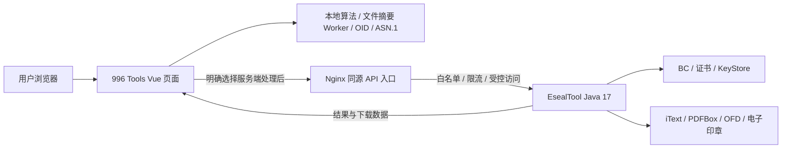

# 996 Tools × EsealTool：功能对比与集成技术可行性

初始评估日期：2026-10-22。当前实施范围更新：2026-10-23。

**历史方案决策（2026-10-22）：选定 B. 原生页面 + Java 服务，首轮 PDF、OFD 复用参考 Java 实现。** 此决定随后调整为本地化；当前 OFD/电子印章三个功能与全部 Java 接入已移除，B 方案仅保留历史记录。

**PKI 实施调整（2026-10-22）：常用 PKI 改为纯前端实现，从工作台拆成公钥基础设施下的 8 个独立工具：CSR 制作、CSR 解析、PFX/PKCS#12、自签证书、证书链验证、证书验签、证书加密、证书数字信封。本次不实现 TLS/SSL 调试。** 当前边界与测试见[本地 PKI 工具使用与验收](本地PKI工具使用与验收.md)，本文旧 PKI/Java 对比表保留历史决策视角。

**2026-10-23 当前范围：全站保留 36 个工具，零 Java 运行依赖。PDF 验签、常用 PKI 和离线 OCSP/CRL 使用纯前端；OFD 签章验签、OFD 签章诊断、电子印章制作及 Java 服务接入已删除，本轮不重写。** 原 PDF 签章、预览、批量和 KeyStore/TrustStore 独立功能也保持移除，PFX/PKCS#12 继续提供。详见[PDF 本地验签与离线 OCSP/CRL](PDF验签前端迁移评估.md)和[OFD 与电子印章纯前端可行性](OFD与电子印章纯前端可行性.md)。下文参考项目条目描述历史能力，不代表本项目仍提供已删除功能。

初始评估对象：本项目 `E:\001---workspaces\002-web\996-tools`，参考项目 `tmp\esealTool`。当时按两者工作区源码分析，包含暂存和未提交修改；当时本项目 HEAD 为 `6c1c8de`，参考项目 HEAD 为 `93332ee`，提交号不能单独代表评估的完整版本。

本文保留集成前的功能分析及架构决策，供追溯。第 2～10 节和第 12 节保留初始评估/首次交付视角，其中“当前”“首版”“待验证”均指当时状态，不作为现行功能或待办清单。**当前结论看第 1、13 节**，运行及验证证据见[运行与验收说明](EsealTool集成运行与验收.md)和[PDF 最终实施记录](PDF验签前端迁移评估.md)。

## 1. 结论

**当前项目运行完全采用前端实现，共 36 个工具，不依赖 Java。** PDF 仅提供本地验签；常用 PKI 和离线 OCSP/CRL 在浏览器 Worker 运行。OFD 签章验签、OFD 签章诊断和电子印章制作三个入口已移除，相关 Java 服务、API 接入与专用部署配置同时移除。

- **保留并增强已有能力**：996 Tools 已有 SM2、SM3、SM4、证书查看、ASN.1、编码转换及部分 P7 功能，优先修正兼容性、补文件摘要和密钥格式转换，不重复建设同类入口。
- **保留增量能力**：PDF 本地验签、CSR/证书、证书链、PFX、证书加密/信封，以及离线 OCSP/CRL；KeyStore/TrustStore 独立管理已移除。
- **运行与测试分离**：应用只需前端静态部署；Java/BouncyCastle、iText 仅可用于独立互操作测试或 PDF 样本生成，不随应用运行。未新增数据库、账户体系、Redis 或任务平台。
- **被移除功能可前端重建**：Canvas/SVG 印章图片较直接；SES 制章、签名及授权验证需要 ASN.1/SM2 等能力；OFD 还涉及 ZIP/XML、规范化摘要、签章结构、坐标和字体渲染，必须独立互通。本轮仅移除，不承诺重建。
- **验证与信任分开**：PDF 只在本地解析/提取证书并验证受支持签名、摘要及覆盖范围，不要求吊销证据或 TSA 信任锚。离线 OCSP 响应由用户指定状态并提供授权密钥签发，不代表真实在线吊销状态；不连接 OCSP、CRL 或 AIA 服务。
- **生产电子签章需要额外建设**：现有代码不能直接提供完整的可信签署平台。正式 CA、印章授权、吊销检查、可信时间戳、HSM、审计和第三方互操作不属于简单嵌入即可获得的能力。

| 目标 | 可行性判断 | 主要前提 |
| --- | --- | --- |
| 扩展开发者本地工具 | 高 | 沿用现有 Vue/TypeScript 和浏览器算法，增加格式及测试向量 |
| PDF 本地验签及离线 OCSP/CRL | 已实现，限明确支持的封装 | 使用浏览器 Worker，提供本地材料，区分数学结果、范围和未知信任 |
| OFD 签章、诊断及电子印章纯前端重建 | 技术上可行，当前已移除且未重建 | ASN.1/SES、ZIP/XML 规范、签名与授权验证、坐标/字体渲染及独立互通 |
| 本地 PKI 与 PFX 创建 | 已实现 | 浏览器本地处理；私钥格式、算法与导出边界见独立验收文档 |
| 当前工具静态部署 | 可行 | HTTPS 或 localhost 支持 WebCrypto；不需要 Java API 服务 |
| 商业化可信电子签章平台 | 有条件可行，另立项目范围 | 授权核实、正式信任体系、密钥设施及互操作验收 |

## 2. EsealTool 功能列表（参考项目初始盘点）

参考项目为 Java 17、Spring Boot 3.5.16、BouncyCastle 1.84 的多模块工具箱；版本来自 POM 声明。PDF 使用 iText 9.6.0，服务端预览使用 PDFBox 3.0.4，OFD 主要使用 Java ZIP/XML 实现。Web 使用 Vue 3、TypeScript、Vite 5 和 Ant Design Vue 4。

以下 `E/` 代表 `tmp/esealTool/`。Controller 均位于 `E/esealtool-server/src/main/java/com/esealtool/server/controller/`；视图位于 `E/esealtool-web/src/views/`。

| 编号 | 功能 | 已有能力与入口 | 实现范围及限制 |
| --- | --- | --- | --- |
| F01 | SM2 密钥与转换 | `/sm2`；生成密钥对，裸密钥、PKCS#8、SPKI 等格式转换；`Sm2Controller` | 服务端 BouncyCastle 处理；基础算法接口有 `userId` 参数 |
| F02 | SM2 签名、验签、加解密 | `/sm2`；签名值格式、C1C3C2/C1C2C3 密文模式 | 要统一消息字节、签名预处理、userId 和 DER/裸签名定义才能与本项目互通 |
| F03 | SM3 文本/文件摘要 | `/sm3`；文本摘要，另有 `/crypto/sm3/hash-file` 接口 | Web 当前文件页走多算法摘要接口，不能只按旧文档判断 |
| F04 | 多算法文件摘要 | `/digest` 复用 `Sm3View.vue`；一次上传计算 MD5、SHA-1、SHA-256、SM3；`FileDigestController` | 当前单文件上限 500 MB，服务端以输入流计算；不是浏览器本地计算 |
| F05 | SM4 | `/sm4`；随机密钥、ECB/CBC 加解密、CBC 自动 IV | 当前服务端 CBC 解密缺 IV 时也会随机生成，需修正后复用 |
| F06 | 文本/文件转码 | `/codec`；UTF-8、Hex、Base64，文件转码与还原下载 | 浏览器本地完成；更改下载后缀不等于转换真实文件格式 |
| F07 | 证书解析和检测 | `/cert`；解析 X.509、展示扩展与安全检测；`CertificateController` | 证书字段解析、安全提示与信任验证是不同能力 |
| F08 | 密钥对、自签根与子证书 | `/cert`、`/pki`；RSA/EC/SM2 密钥，自签证书，根与子证书生成，SAN 和用途设置 | `PkiController` 的 `keygen/selfsign/selfsign-new/root-and-child` 等；自行生成根不自动获得外部信任 |
| F09 | CSR 与 CA 签发 | `/pki`；PKCS#10 制作/解析、CSR 或公钥签发、扩展配置 | `csr/csr/parse/sign-csr/issue`；操作需要私钥或 CA 材料 |
| F10 | 证书链检查 | `/pki`；链排序、逐环验签、有效期及问题诊断 | 与指定 TrustStore 的信任路径验证分开提供 |
| F11 | 证书/密钥格式转换 | `/pki`；PEM、DER、PKCS#1、PKCS#8、SPKI 等 | 包含结构转换，超过普通 Base64/Hex 外层编码转换 |
| F12 | 数据签名与 CMS/PKCS#7 | `/pki`；数据签名/验签，CMS 签名/验签，certs-only 证书包 | 用 Java 实现作为交叉验证端；不能假定与现有浏览器 P7 已互通 |
| F13 | PKCS#12/PFX | `/pki`；由私钥和证书链创建容器，设置别名与密码 | 输出下载；不是持久化密钥托管系统 |
| F14 | KeyStore 管理 | `/keystore`；JKS/PKCS12 创建、查看、密钥生成、证书导入导出、CA 回复、链追加、CSR、删除、改密、格式转换 | `KeyStoreController`；处理用户提供的库并返回结果，不能当作已有云密钥仓库 |
| F15 | TrustStore/PKIX | `/keystore`；创建信任库，检查叶子证书能否连接到所选信任锚 | `JavaTrustStoreValidationService` 明确关闭吊销检查 |
| F16 | TLS/SSL 调试 | `/pki`；指定主机握手，查看协议、套件、证书链和信任结果 | 需要服务端 TCP/TLS 能力；存在客户端 KeyStore 配置模型，但 mTLS 需重做实测；不是已证明支持国密双证书 TLS |
| F17 | 印章图片生成 | `/seal`；圆形、椭圆、方形，文字/图形配置，PNG 预览与下载 | Java 2D 绘制；图片本身不包含数字签名或可信身份 |
| F18 | 电子印章数据 | `/seal`；DER 构造、解析、制章签名验证；一键生成制章者/签章者证书及印章 | `SealController` 的 `eseal/build/parse/verify/quick-build`；采用 GB/T 38540 风格结构，实际互操作仍需样本验证 |
| F19 | PDF 签名和验签 | `/pdf`；SM2/SM3、签名列表、内嵌证书提取、多修订检查 | 证书+PNG 走 SES，仅证书走分离式 CMS；旧 SDK 原始 SM2 路径仅作兼容；Java Web 签章路径检查签名者证书与私钥匹配 |
| F20 | OFD 签名和验签 | `/ofd`；SES、签名列表、引用文件 SM3 摘要、StampAnnot、证书提取 | Web 标准签章需要证书和 PNG；非当前支持的算法/封装仍需扩展 |
| F21 | 预览与签章位置 | `/pdf`、`/ofd`；单点、多位置、关键词第 N 次命中、连续/重叠骑缝 | PDF 用 PDFBox 预览，复杂旋转/裁剪页面禁用点击选点；OFD 为简化布局。扫描图片无内置 OCR，不能直接按关键词定位 |
| F22 | 批量签名 | `BatchSignPanel.vue`；逐份处理、结果清单、成功文件 ZIP | 最多 20 份，单份 20 MB，合计 100 MB；浏览器顺序调用单文件接口并打包，没有服务端队列或断点续作 |
| F23 | 签章 Debugger | `/debug`；PDF/OFD 结构、证书来源、摘要过程和签名结果，证书提取下载 | 用于诊断，不代替可信性判定 |
| F24 | ASN.1 结构解析 | `/asn1`；文本/文件，Hex/Base64/PEM/DER，结构树、节点详情 | Java 解析，前端显示中文说明；存在解析长度/深度保护 |
| F25 | OID 查询 | `/oid`；中文名称、描述、分类/关键词过滤、精确查询与上级提示 | `/api/v1/asn1/oids`、`/oid/{oid}`；可作为本项目本地词典来源候选 |
| F26 | SDK、CLI、编辑器扩展 | Java SDK、picocli CLI，VS Code/IDEA 编排 CLI | 可用于互操作测试与开发者下载；IDE 插件不能作为 Vue 组件直接嵌入，第一阶段不迁入 |

补充基础设施：项目包含 Dockerfile、Compose、Java 单元/集成测试和历史验证报告。OFD ZIP 解压有条目数、单项/总解压量及路径检查。这些值得保留，但不能据此推断已经具备用户认证、持久化审计、生产 CA 或 SaaS 多租户能力。

## 3. 集成前本项目现状与功能差异（历史评估）

### 3.1 集成前 996 Tools 的真实基线

本项目是 **Vue 3.5 + TypeScript 5.7 + Vite 6 + Tailwind CSS + Pinia + vue-i18n 的纯前端工具站**，Docker 运行层是 Nginx。集成前未见业务后端、用户登录、数据库或服务器文件管理模块。不能把这些作为现成集成基础。

集成前源码路由和 `tools-data.ts` 各登记了 **24 个工具**，README 的简要清单滞后于源码：

| 类别 | 当前入口 |
| --- | --- |
| 编码与数据查看（3） | 编码转换、证书编码转换、二进制查看器 |
| 密码工具（6） | 文本哈希、SM2 综合工具、SM2 加解密、SM2 签名验签、SM4、数字信封 |
| PKI 查看（2） | 证书 ASN.1 解析、证书查看器 |
| JSON/配置/CSV（8） | JSON 格式化、代码生成、JSON 查询、JSON 对比、JSON 可视化、配置格式互转、YAML/TOML/Properties 编辑器、CSV 高级操作 |
| 生成器（5） | UUID、Nano ID、ULID、密码、二维码 |

已有的通用体验包括分类导航、搜索、收藏、明暗主题和中英文。当前有效工具路由挂在 `DashboardLayout.vue` 下；仓库虽有 `PortalLayout.vue` 等组件，接入时应依据实际路由，不应仅凭文件名选择布局。

### 3.2 对比与接入决策

“新增”指新增面向用户的能力；“增强”指沿用本项目入口补齐功能，不建立第二个重复工具。

| 能力 | 996 Tools 现状 | EsealTool 增量 | 建议与可行性 |
| --- | --- | --- | --- |
| SM2 密钥、加解密、裸签名/DER | 已有，`sm-crypto` + 自定义 ASN.1；综合与拆分入口并存 | 更完整的密钥格式、userId、PKI 联动 | **增强，高**；保留本地处理，先做 JS/Java 交叉验证 |
| SM3/其他文本哈希 | 已有 SM3、MD5、SHA 系列等 | 主要增量是文件摘要 | **增强，高**；算法覆盖不需重复迁入 |
| 文件摘要 | `HashText` 目前输入文本，未见独立大文件摘要链路 | 四算法、流式、500 MB 限额 | **新增，高**；优先浏览器 Worker + 增量摘要，服务端大文件模式可选 |
| SM4 ECB/CBC | 已有，包含随机密钥/IV 和“一键带入解密” | 无明显产品缺口 | **保留**；不要引入参考项目缺 IV 随机解密的行为 |
| 转码 | 已有 UTF-8/GBK、Base64/Hex、文件加载/二进制下载 | 更细的文件名/MIME 体验 | **增强，高**；本项目 GBK 支持应保留 |
| ASN.1 | 已有本地 iframe 解码页，可查看 DER/BER 多类结构 | 中文结构详情、Java 语义说明 | **增强，中高**；优先本地语义和 OID，服务器解析作为可选诊断 |
| OID | 有 `certificateOids.ts`、密码模块 OID 常量 | 独立搜索页、分类、最近上级提示 | **新增，高**；统一词典后增加本地查询页面 |
| X.509 证书查看 | 已有 RSA/国密兼容解析、行业 OID 和有效期展示 | 安全检测、链验证联动 | **增强，中高**；当前有效期判断不能视为证书签名/信任检查 |
| 证书与密钥转换 | 已有 PEM/Base64/Hex/DER 外层编码转换 | PKCS#1/PKCS#8/SPKI 结构转换、私钥导出公钥 | **增强，中**；分别展示“编码转换”和“密钥结构转换” |
| P7/CMS | 有 attached/detached、DER/PEM、单签名者和可选证书结构 | Java CMS、证书包、更多证书处理 | **修复后增强，中**；存在第 4 节所述确定问题，不能按文档认定已全面兼容 |
| 数字信封 | 已有 SM2+SM4 和 ASN.1 结构路径 | 参考 Web 未见同等独立工具入口 | **保留**；当前单接收者假设也应独立做标准互操作验证 |
| 密钥生成、自签证书、CSR、CA 签发 | 仅 SM2 工具密钥生成，不是完整 PKI 工作流 | F08/F09 | **新增，中高**；按已选 B 方案接入原生页面 + Java 服务，RSA/SM2 不应混用浏览器能力假设 |
| 证书链、PFX、JKS、TrustStore、TLS | 未见完整页面/业务实现 | F10、F13～F16 | **新增，中高**；Java 复用价值高；TLS 单独限权 |
| 印章图片 | 未见 | F17 | **新增，高**；Java 原图复用或另做 Canvas 本地绘图，后者需视觉校验 |
| 电子印章 DER | 未见 | F18 | **新增，中**；复用 Java，保留证书/印章验证的独立结果 |
| PDF/OFD 签章、验签、预览、骑缝 | 未见 | F19～F21 | **已确定按 B 方案接入，中高**；沿用现有 Java Controller/ApplicationService/PDF/OFD 模块，主站实现原生页面和参数适配 |
| 批量签章、Debugger | 未见 | F22/F23 | **新增，中高**；首版复用顺序批处理，不宣称后台任务 |
| SDK/CLI/IDE | 本项目是 Web 工具站 | F26 | **暂不迁入**；保留上游分发入口、用于验收及自动化 |
| JSON、配置、CSV、ID、二维码 | 本项目现有优势 | 参考项目不以此为重点 | **保留**，与新增 PKI/签章工具并列 |

### 3.3 技术差异

| 项目 | 996 Tools | EsealTool | 集成影响 |
| --- | --- | --- | --- |
| 页面框架 | Vue 3.5、Vue Router 4 | Vue 3.5、Vue Router 4 | 组件逻辑可移植；不需要再启动第二个 Vue 应用来实现原生工具 |
| UI | Tailwind、自有 Base 组件、Lucide、i18n | Ant Design Vue、Ant 图标、自有全局 CSS | 不能直接复制模板就编译；建议改为 Base 组件，过渡时也只能按需引入 Ant |
| 构建 | Vite 6、TS 5.7、pnpm | Vite 5、TS 5.6、npm；另有 Maven | 保留两套独立构建；不将上游 package.json/锁文件覆盖进主项目 |
| 路由 | History，`/tools/...` | Hash，`/#/pdf` 等 | 原生页面注册主路由；iframe 才保留上游 Hash |
| 算法执行 | `sm-crypto`、`crypto-js`、`node-forge`、PKI.js 等在浏览器执行 | 除转码外多数通过 Java API | 页面移植必须附带请求适配，且改变文件/私钥数据去向 |
| API | 未见通用业务 API 客户端 | `/api/v1/...`，JSON/multipart，业务成功码 `0` | 新增请求层；HTTP 成功与业务成功分别检查 |
| 状态/存储 | 收藏、主题等浏览器偏好 | 基本按请求处理；测试根有文件持久化 | 默认不新增文件历史与云密钥库，避免无必要引入数据库 |
| 部署 | 静态 Nginx 单服务 | Java 17 服务，默认 18080，可自带 Web | 完整扩展版增加 Java 容器及反向代理，Java 端口不直接公网映射；静态精简版保留 |

## 4. 集成前必须澄清的实现问题（历史评估）

### 4.1 初始 P7 问题及本次修复

集成前 `src/utils/crypto/asn1/signed-data.ts` 的 `computeSM3Digest()` 先把原始字节转成 Hex 字符串，再调用 `sm3(hex)`。评估时已使用本项目安装的 `sm-crypto` 做最小验证：

```text
原始 UTF-8 "abc" / 字节 [97,98,99] 的 SM3：
66c7f0f462eeedd9d1f2d46bdc10e4e24167c4875cf2f7a2297da02b8f4ba8e0

旧辅助函数所传 Hex 文本 "616263" 的 SM3：
00607cd3ffb78125184758bb06d23757beb3d57be9447b1bb58a6a6e67752313
```

这意味着 P7 内的消息摘要可能对 Hex 文本求值，无法因为本项目“自己签、自己验”而认定与 Java CMS 一致。应修正字节输入，并完整核对 SM2 的 ZA/userId、signedAttributes DER 编码、签名前摘要语义及 OID；不能只改一处摘要就宣布互通。

另外，旧 `verifyP7SignedData()` 在有内嵌证书但未手填公钥时明确返回 `Public key extraction from certificate not yet implemented`。因此 `doc/P7-Implementation-Summary.md` 中自动提取证书公钥的描述不能作为已完成依据。旧实现只取第一个 SignerInfo。

**本次已修复**：按原始字节计算 SM3，按 DER 排序签名属性，采用 SM2 ZA/userId 语义，匹配签名者证书并提取公钥；拒绝不支持算法、多签名者及非规范属性。修正 Buffer/TypedArray 子视图边界和空内容内嵌编码，识别为 P7 后不回退成裸签名。已通过 Java CMS 双向内嵌/分离签名、空消息和篡改测试。该浏览器实现仍限定单签名者 SM2/SM3；Java 工作台处理更多 CMS 类型，信任链需单独验证。

### 4.2 参考项目的边界

| 问题 | 源码/现象 | 集成处理 |
| --- | --- | --- |
| 测试根被签章路径使用 | `TestSealAuthorityService` 持久化 `.run/test-seal-maker.p12`，密码为空；`PdfApplicationService.sign()` 对证书+图片调用测试根制章 | 不仅隐藏“生成测试证书”按钮，还要替换/禁用这条自动制章路径。正式签章需可信电子印章材料或外部签章提供方 |
| 验签未汇总完整信任 | 文档验签、电子印章验签、TrustStore 校验分散；PKIX 关闭 revocation | 分别显示完整性、签名值、证书信任、印章、吊销状态；未知项不得显示为“可信” |
| PDF/OFD 外部样本支持有限 | 默认 SM2 userId、当前 SES/OFD 摘要算法；复杂封装依赖实现 | 制定厂商/阅读器样本矩阵，不将解析失败等同于文件被篡改 |
| 预览有明确限制 | PDF 返回 `selectable`，旋转/裁剪偏移/UserUnit 特殊时为 false；OFD 简化预览 | 继承能力标志并禁用不可靠选点；复杂文档明确要求人工复核 |
| 文件大小不是统一 20 MB | Spring multipart 为 500/501 MB，普通业务校验 20 MB，摘要特例 500 MB | 网关、页面、业务服务按工具分别限额，不能使用单一全局大上限 |
| 上传扩展名保护不是所有路径都有 | PDF/OFD 多数使用 `readAnyType()`，只执行大小等通用校验，随后才进入格式解析 | 保留解析器检查，并补内容类型、页数/像素/解压资源限制，不能仅依赖 accept 或后缀 |
| SM4 CBC 解密行为 | `Sm4ApplicationService` 无 IV 时在加密/解密两条路径都生成随机 IV | 解密无 IV 返回明确错误；本项目现有本地 SM4 无需迁入此实现 |
| 缺少面向公网的权限层 | server POM/config/controller 中未见完整业务认证授权；CORS 广泛放行，Compose 映射 18080 | 新建访问策略和接口白名单；CORS 不等于权限控制 |
| TLS 可连接用户指定主机 | `DefaultTlsDebugService` 接受 host/port 并建立 socket | 只对受控部署开放；限制目标、端口、出网与解析地址，防止访问未授权内网服务 |

## 5. 集成方式比较（历史方案，当前范围见第 1、13 节）

**决策状态：B 方案已选定，作为后续实施基线。** 其余方案保留用于说明取舍，不再作为待选择项。PDF/OFD 按现有 Java 功能接入，具体复用边界见第 5.3 节。

| 方案 | 具体方式 | 优点 | 成本/约束 | 建议 |
| --- | --- | --- | --- | --- |
| A. iframe 嵌入 | 新工具页嵌入独立构建的 EsealTool Web，Java 单独部署 | 演示快，隔离 Ant 样式；本项目 ASN.1 已有本地 iframe 先例 | 两套导航/主题/i18n；仍须 API、资源路径、访问控制和上传说明；无法解决后端缺失 | 未选；仅保留内部原型参考 |
| **B. 原生页面 + Java 服务** | 提取需要的页面逻辑，接入主项目 Base 组件、路由、词典；PDF/OFD 等直接复用当前 Java 服务 | 导航一致，避免重复工具；成熟密码/文档逻辑继续复用 | 需要逐页改造模板、API 适配和样本验证 | **已选定，实施主线** |
| C. 全部浏览器重写 | Java 算法、JKS、PDF/OFD 签名迁为 JS/WASM | 可保持所有数据本地 | PDF ByteRange/CMS/SES、增量修订、OFD 签章和 JKS 实现成本高；浏览器不能直接完成通用 TCP/TLS 握手诊断 | 仅用于文件摘要、OID、PNG 等独立小功能，不建议作为全量方案 |
| D. 微前端框架 | 接入子应用运行时 | 可独立发布上游 Web | 当前仅一个参考工具箱，增加路由、依赖和鉴权复杂度 | 暂无引入必要 |

### 5.1 已选 B 方案的结构



在 B 方案下保留两种部署形态，完整功能以扩展版为交付目标：

1. **静态精简版（兼容/回退）**：只部署当前 Nginx，已有 24 个工具及新增本地功能可用，不包含 PDF/OFD 等 Java 能力。服务端开关关闭，不自动上传数据或尝试后台连接。
2. **完整扩展版（B 方案）**：Nginx + Java 容器，受控转发指定 API；Java 是 PDF/OFD 等扩展功能的必需运行组件。页面按运行位置标为“本地处理”或“服务端处理”，后者说明上传内容和保留策略。

首版仍采用请求内计算和下载，不建设账户余额、数据库、持久化任务中心。后续确有团队资产、长期审计、异步队列需求，再增加对应服务和数据模型。

### 5.2 原生页面的落地位置

建议目录和名称如下，均为待新增/改造：

```text
src/api/eseal-client.ts                  # 同源请求、超时、取消、业务错误处理
src/types/eseal.ts                       # Java DTO 的前端类型及结果枚举
src/composables/useToolCapabilities.ts   # 本地/服务端能力开关和可用状态
src/components/eseal/                   # 文件选择、定位、证据详情等共享组件
src/workers/file-digest.worker.ts        # 可选：浏览器增量文件摘要
src/views/tools/FileDigest/              # 文件摘要
src/views/tools/OidExplorer/             # OID 查询
src/views/tools/PkiWorkbench/            # CSR、自签与证书链等
src/views/tools/KeyStore/                # 库操作与信任验证
src/views/tools/SealGenerator/           # 图片及电子印章数据
src/views/tools/PdfSeal/                 # PDF 验签/签章
src/views/tools/OfdSeal/                 # OFD 验签/签章
src/views/tools/SignatureDebugger/       # 签章诊断
services/esealtool/                      # 经筛选的 Java 源码或固定版本引用
docker-compose.eseal.yml                 # B 方案完整扩展版部署
```

每个新工具遵循现有开发指南的四处接入：工具视图和 composable、`src/lib/tools-data.ts` 元数据、`src/router/index.ts` 懒加载路由、`locales/zh.yml` 与 `locales/en.yml`。分类沿用 `pki`/`Encryption_Tools`，文档签章可新增 `Document_Tools`，同时补分类排序与图标映射。

建议在现有 `Tool` 类型新增 `execution: 'local' | 'server'`、`requiresBackend` 等元数据，由搜索、侧栏、卡片统一显示。不要只隐藏首页入口而让搜索仍能进入不可用页面。当前没有标准健康/能力查询 API 可直接依赖；可先用部署配置开关，再新增只返回公开能力、版本与限额的接口。

可复用的上游前端逻辑：`SealPlacementForm.vue` 的位置组装/单位换算、`DocumentPreviewPicker.vue` 的选点与能力判断、`VerificationDetails.vue` 的证据展开、`BatchSignPanel.vue` 的逐文件结果和失败处理。迁入时替换 Ant 组件、提示消息、硬编码文案、请求客户端及全局 CSS；不能导入上游 `main.ts` 和整个 `App.vue` 重新挂载。

### 5.3 PDF / OFD 按现有 Java 实现接入

“按当前 Java 实现接入”指复用参考项目现有模块和调用链，在主项目完成原生页面、请求适配、部署与验证；服务端仅按接口统一、已知问题及验收需要做针对性调整。签章算法、PDF 增量修订、OFD ZIP/XML 与 SES 结构继续由 Java 负责。

| 能力 | 现有 Java 调用链/接口 | 996 Tools 接入工作 |
| --- | --- | --- |
| PDF 签章、验签、签名列表 | `PdfController → PdfApplicationService → PdfService / ItextPdfService`；`/api/v1/pdf/sign`、`verify`、`signatures` | 新增 `PdfSeal` 原生页面，上传文件、密钥/证书/图片与定位参数，展示结果并下载 PDF |
| OFD 签章、验签、签名列表 | `OfdController → OfdApplicationService → OfdService / ZipOfdService`；`/api/v1/ofd/sign`、`verify`、`signatures` | 新增 `OfdSeal` 原生页面，沿用现有 SES、引用摘要、StampAnnot 和 ZIP 防护逻辑 |
| PDF / OFD 预览 | `DocumentPreviewController → DocumentPreviewService`；`/api/v1/preview/pdf`、`ofd` | 展示页面与选点信息，遵守 `selectable` 限制；PDF 参数由 mm 转 pt，OFD 保持 mm |
| 签章结构诊断 | `DebuggerController` 与 `esealtool-debugger`；`/api/v1/debugger/pdf`、`ofd` | 新增 `SignatureDebugger` 页面，复用证据详情与证书下载交互 |
| 多位置、关键词、骑缝 | 现有 `position`、`keyword`、`keywordIndex`、`qifeng`、`qifengOverlap`、`qifengPages`、`qifengPieces` 参数及 `SealPlacementParser/Resolver` | 复用上游定位表单逻辑，替换为本项目 Base 组件；批量先沿用逐文件调用 |

首版 Java 保留 `esealtool-server` 及其当前依赖的 `common`、`crypto`、`asn1`、`certificate`、`pdf`、`ofd`、`seal`、`debugger` 模块，使用父 Maven 工程统一版本；不在接入初期拆散服务端依赖。主站负责 Web 展示，不要求部署参考项目的整套 Ant Design Web。

接口先保持当前数据形态：签章使用 multipart，显式传递 `privateKey`、`keyFormat`、`certificate`、`sealImage` 和位置参数；响应按 `ApiResponse` 检查业务码，再将 `{base64,fileName}` 解码为实际 PDF/OFD 文件下载。验签按现有接口传文档及可选公钥/证书，结果模型在前端适配层统一；编码显示选项与签章文件二进制下载分开处理。

接入顺序确定为：**Java 服务与同源代理 → 原生验签/列表/诊断页面 → 原生预览与单份签章 → 多位置/骑缝/批量**。第 4.2 节记录的测试根、信任结果与预览限制继续作为针对性处理项；复用当前实现不代表跳过真实文件、篡改样本和第三方阅读器验收。

### 5.4 iframe 原型参考（未选用）

以下仅保留对比方案的技术备忘，不纳入 B 方案实施排期。如未来另行采用内部原型，可使用主路由 `/tools/eseal-workbench` 嵌入 `/embedded/eseal/#/pdf`：

- 上游 Vite 配置静态资源 base 为 `/embedded/eseal/`，构建产物独立存放，避免覆盖主站 index/assets。
- 上游现有请求是绝对路径 `/api/v1/...`，仅修改 Axios `baseURL` 不一定得到预期路径；应统一改写请求前缀或提供独立同源映射。
- Nginx 必须分别处理嵌入页静态资源、Java API、主站 History fallback，不能把 API 的 404/500 转成主站 HTML。
- iframe 只嵌入受控地址；如使用 postMessage 同步主题/语言，校验 origin、source 和消息 schema，不传私钥/库密码。评估下载、剪贴板、CSP 与 sandbox 的实际兼容性。
- 不以“页面在 iframe 中”推断文件未上传；签章/PKI 请求仍会到 Java 服务。

## 6. 接口与数据流设计（初始方案存档）

### 6.1 请求约定

建议主站公开前缀为 **`/api/eseal/v1`**，代理到 Java 的 **`/api/v1`**。Vite 开发代理和 Nginx 生产代理采用相同规则。使用固定上游地址，不能允许用户通过请求参数指定任意 Java 服务 URL。

| 能力 | Java 已有接口 | 数据/结果 | 首批建议 |
| --- | --- | --- | --- |
| 证书解析/检测 | `POST /api/v1/certificate/parse`、`inspect` | 文件 multipart → 证书/检测结果 | 开放只读模式 |
| 文件摘要 | `POST /api/v1/crypto/digest/file` | 文件 multipart → 四种摘要 | 可选；浏览器本地模式优先 |
| OID | `GET /api/v1/asn1/oids`、`oid/{oid}` | JSON 词典/详情 | 本地词典优先 |
| PDF/OFD 验签和列表 | `POST /api/v1/pdf/verify`、`signatures`；OFD 对应路径 | 文件、可选公钥/证书 → 结果 | 服务端最小闭环 |
| 单页预览 | `POST /api/v1/preview/pdf`、`ofd` | 文件+页码 → 页数/尺寸/rotation/selectable/imageBase64/note | 只在需要预览时调用 |
| 签章诊断 | `POST /api/v1/debugger/pdf`、`ofd` | 文件 → 结构、证书及验证过程 | 与只读验签一起接入 |
| 签章 | `POST /api/v1/pdf/sign`、`ofd/sign` | 文档、私钥、证书、图片、位置参数 → `{base64,fileName}` | 受控签章阶段再开放 |
| 印章 | `POST /api/v1/seal/generate`、`eseal/*` | JSON/编码材料 → 图片或电子印章数据 | 图片与含私钥操作分开授权 |
| PKI/KeyStore | `POST /api/v1/pki/*`、`keystore/*` | JSON 或 multipart，部分 options 为 JSON 字符串 | 明确端点白名单，不能开放通配代理作为公网默认配置 |

`eseal-client.ts` 至少应：检查 HTTP 状态；解析 `code === 0` 的业务成功；统一错误码/可读提示；对 FormData 不手写 boundary；提供 AbortController/超时；下载响应释放 object URL；不记录请求体中的密钥、密码、原文或完整结果。

上游通用 Axios 超时为 30 秒，摘要页单独设为无限等待。接入后应使用按能力可配置的有界超时，禁止直接复制无限超时；“浏览器取消请求”也不能被描述为“Java 已经停止计算”，后端取消需要另外实现。

### 6.2 文件与密钥数据流

**只读验签：** 用户选文件 → 确认服务端处理模式 → multipart 上传到同源入口 → Java 校验/解析 → 返回结构化证据 → 浏览器展示/下载。默认不建立云端文件历史，刷新后不承诺恢复。

**现有签章 API：** 浏览器提供文档、签名私钥、证书和参数 → Java 签名 → Base64 结果返回。该流程明确包含私钥传输，不能宣称“私钥始终不离开浏览器”。建议首版只在用户控制的本地或私有服务中启用；公网生产签署改用受管签名器、HSM/外部签章服务或专门设计的外部签名协议。

如果要求“服务端排版，但私钥绝不离开浏览器”，需要新增准备签名/返回待签数据、客户端签名、服务端嵌入并验证的协议，处理 PDF ByteRange、保留签名长度、会话绑定和失败重试。当前 Java Controller 没有这套拆分接口，不能作为零改造方案。

上传暂存、Nginx 请求缓冲、Servlet multipart 临时目录、错误日志和进程转储都需要纳入生命周期设计；“业务不主动保存”不等于“任何磁盘均不落地”。建议结果不长期保存，临时文件按请求完成和超时双路径清理；私钥/口令不进入 Pinia 持久化、localStorage、URL 或日志。

### 6.3 文件限额、性能与批量

- 首版 PDF/OFD 沿用单文档 20 MB，证书/图片另设更小限额，multipart 总大小为多部件留出空间。页数、预览像素、解压量、并发数同时限制。
- 500 MB 摘要是上游能力上限，不应成为主站统一上传上限；需要网关、磁盘、超时和流式验证后再按部署配置启用。浏览器本地大文件摘要需真正的增量实现与 Worker；不能把每块摘要拼起来当作整文件摘要，也不能假定 Web Crypto 原生支持 SM3。
- 当前签章返回 Base64，编码体积约为二进制的 4/3，浏览器还会保留字符串、解码数组和 ZIP 副本。首版限制文件和批次数量；后续增加二进制流式下载，另做 API 版本兼容。
- 批量可先沿用顺序调用和部分成功列表，已有 `jszip` 可评估用于下载包，不必再引入重复 ZIP 库。关闭页面会丢失当前批次状态。
- 真正后台任务要新增任务 ID、状态、取消语义、幂等、结果过期和访问隔离；这些均不是参考项目现成能力，暂不列入最小版本。

### 6.4 坐标与验证结果

PDF Web 表单使用 mm，Java PDF 接口使用 pt：`pt = mm × 72 / 25.4`；OFD 坐标使用 mm。迁移时复用并验证原定位逻辑，同时明确页码从 1 开始、坐标原点、印章中心/边界定义、页面缩放和 Y 轴方向。不要仅换算单位而忽略锚点。

建议结果模型分别记录 `integrity`、`signature`、`certificateTrust`、`sealValidity`、`revocation`、`timestamp`，状态至少区分 `pass/fail/unknown/unsupported`。字段是建议新增的统一模型，不是上游已经完整返回。未检查吊销或时间戳时显示“未检查”，不能用一个绿色“成功”覆盖所有维度。

## 7. 部署、依赖和授权（初始方案存档）

1. **不依赖 tmp 作为正式发布源。** 将经过筛选的 Java 源码迁至 `services/esealtool`，或固定到受控仓库/镜像版本，记录上游来源与本地补丁。不要直接把参考目录中的 `.run`、测试密钥库、样本文件或构建产物带入发布包。
2. **双构建、双容器。** 主站继续 pnpm/Vite/Nginx；Java 使用 Maven/Java 17 独立构建。扩展版只需 Java API 时可以不打包上游 Web，减少重复资源。
3. **API 代理优先于 SPA fallback。** 为 `/api/eseal/` 设置独立代理和错误响应；开发环境同步配置 rewrite。Java 仅暴露容器内部端口，不能原样复制上游 `18080:18080` 到公网部署。
4. **只开放计划中的接口。** 第一阶段只允许验签/解析/诊断所需端点；密钥生成、签名、CA、库修改和 TLS 分阶段开放。受控部署可使用网络隔离或网关身份验证，若建设多用户版再补 Java 侧授权，不能把静态前端隐藏按钮当权限控制。
5. **Docker 上下文需要收敛。** 本项目 Dockerfile 使用 `COPY . .`，当前 `.dockerignore` 未排除 `tmp` 和 `.git`。引入服务前应补排除规则，避免复制参考项目运行材料和无关内容；正式服务目录再明确 COPY。Java 测试根如确需持久化，应使用专门测试卷，不与生产签章凭据混用。
6. **补运行验证。** Java 2D/PDFBox 依赖可用字体和 headless 环境，需检查容器中文印章、PDF 文本与字体回退；配置 CPU/内存、临时磁盘和并发限制，并补健康检查。现有上游 Compose 未提供完整的这些配置。
7. **核实许可。** 996 Tools README 声明 MIT；参考项目扫描未找到根 LICENSE，不能默认其整体代码与素材允许任意复制/商用。PDF 直接依赖 iText，应按实际版本核实 AGPL/商业授权条件及是否已有授权；独立 Java 服务不自动消除相关许可义务。此项是发布前待确认条件，本次未取得授权文件或完成许可审计。

不建议为此次功能扩展新增 NestJS、支付/积分系统或数据库；当前项目没有这些基础，且首版工具箱不需要。

## 8. 分阶段实施与工作量（初始估算存档）

以下按**已选定的 B 方案、复用现有 Java PDF/OFD 实现**估算，主要工作为原生页面、API/部署适配、已知问题处理与回归验证。单位为熟悉 Vue/Java 的开发者人日，包含基础验证但不是承诺工期；未做运行性能测量。正式 CA/HSM、外部签署供应商、全部阅读器认证及许可采购不计入。

| 阶段 | 交付内容 | 估算 | 完成标准 |
| --- | --- | --- | --- |
| P0 基线与互操作 | 固定源码快照，确认许可范围，修正/隔离 P7 问题，建立字节/格式/SM2 userId 契约和测试向量 | 2～3 | 明确现有缺陷；JS/Java 测试计划可执行，不把自验当互通 |
| P1 本地增量 | 文件摘要、OID 查询、密钥格式增强中选首批；沿用现有 UI/i18n | 3～5 | 禁网时可用，文件字节一致，大文件不持续阻塞主线程 |
| P2 服务端只读闭环 | 部署 B 方案 Java 服务、API 客户端/代理；复用现有 PDF/OFD 验签/列表/诊断接口并接入原生页面 | 5～8 | 无服务时旧工具正常；正常/篡改/无签名/不支持样本结果可区分 |
| P3 受控签章 | 复用当前 Java PDF/OFD 签章与预览能力；原生页面接入单点/多位置/关键词/骑缝、图片及电子印章、顺序批处理 | 8～15 | 测试身份清楚，签章位置与字节验证通过，部分失败可下载成功项；不带入测试根作为正式信任 |
| P4 PKI 深化及统一体验 | CSR/签发、证书链、PFX/JKS/TrustStore、受限 TLS、页面与文档完善 | 8～15 | 用代表性库文件/证书链验收，明确吊销与互操作边界 |

完整工具箱主线约 **26～46 人日**。实施先走 P0+P2，完成基于现有 Java 的原生只读验章闭环，约 **7～11 人日**；再推进 P3，P1 可另行排期。iframe 原型不纳入已选 B 方案排期。

密码材料 Hex/Base64、头尾与换行需求已合入 P1：共享组件接入已有密码页面与新 Java 结果面板，显示、复制、文本/二进制下载分别处理。SM2 C1 前缀适配已修复，两种密文顺序通过本地及 Java 交叉验证。详见[格式转换验收记录](密码材料格式转换-进度与待办.md)。

建议第一批产品入口：文件摘要、OID 查询、PDF 验签、OFD 验签、签章诊断。现有 SM2/SM4/转码继续保留，P7 修复后再增强。签署与 CA 功能在受控环境完成验证后发布。

## 9. 验收清单与回退（初始方案存档）

| 验收方向 | 必须覆盖的用例 |
| --- | --- |
| 现有功能回归 | 24 个路由、侧栏/搜索/收藏、深色模式、中英文；关闭后端开关时本地算法仍正常 |
| 编码与算法 | 空文件、中文/GBK、0x00/0xff 二进制；SM3 标准向量；SM2 双向加解密/签验、两种密文顺序、DER/裸格式、默认/非默认 userId；SM4 原 IV 往返 |
| P7 互操作 | JS 签→Java 验与Java 签→JS 验；attached/detached；内嵌证书/手填公钥；内容或属性篡改；多 SignerInfo 不支持时明确返回状态 |
| PDF | 未签、单签、多签/增量修订、尾部未受保护修改、SES/CMS、缺证书；普通 A4 与旋转/裁剪/不同尺寸；第三方阅读器及版本记录 |
| OFD | 标准目录及替代签名目录、引用文件修改、SES 修改、多位置骑缝、复杂字体/路径；不支持摘要算法独立报告 |
| PKI/KeyStore | RSA/SM2、正常/过期链、不可信根、错误私钥、错误密码、JKS/PKCS12 导入导出、CSR；TLS/mTLS 仅对授权测试服务验证 |
| 上传与资源 | 业务/网关超限、空文件、损坏结构、ZIP 路径穿越/重复条目/膨胀、超大页面、并发、超时、客户端取消、临时文件清理 |
| 数据边界 | 本地页不发业务上传请求；服务端页明确上传内容；私钥/口令不出现在 URL、持久化状态、日志和部署上下文 |
| 部署 | 主路由刷新、iframe 子资源（如采用）、API 返回 JSON 而非 SPA HTML；Java 无公网直连；容器重启、能力不可用提示、字体渲染 |

验证入口：本项目 `pnpm build` 会执行 `vue-tsc && vite build`；当前 Dockerfile 只执行 `pnpm exec vite build`，不能把 Docker 构建通过等同于类型检查通过。B 方案需执行参考项目 Maven 测试和本项目 Web 构建，无需部署上游整套 Web。独立格式转换工作已执行 Vite 打包、类型检查和专项测试，结果见[进度记录](密码材料格式转换-进度与待办.md)，仍有失败项；这些不等于 Java/PDF/OFD 已验收，本次尚未运行 Java 端到端验证，也不引用旧报告的通过数量作为当前结果。

回退方式：通过能力开关关闭新增 Java 工具并撤销 API 代理，保留原 24 个本地工具；新页面/静态资源独立发布。首版不改变数据库，因为无需引入数据库。已有 P7 数据如果涉及错误摘要语义，应明确标为旧兼容模式，不能通过静默回退错误算法把验证结果显示为标准通过。

## 10. 关键源码证据（初始评估时点）

下列链接相对于本文件，方便在仓库内定位。本次不以 README 功能宣传替代实现核对。

| 结论/用途 | 证据 |
| --- | --- |
| 主项目技术栈、工具清单与路由 | [package.json](../package.json)、[tools-data.ts](../src/lib/tools-data.ts)、[router](../src/router/index.ts)、[工具开发指南](工具开发指南.md) |
| 本地密码与文件处理基线 | [HashText](../src/views/tools/HashText/useHashText.ts)、[SM2 加解密](../src/views/tools/Sm2Encrypt/useSm2Encrypt.ts)、[SM4](../src/views/tools/Sm4Tool/useSm4Tool.ts)、[转码](../src/views/tools/Transcoding/useTranscoding.ts) |
| P7 功能及确定缺口 | [签名页面逻辑](../src/views/tools/Sm2Sign/useSm2Sign.ts)、[SignedData 实现](../src/utils/crypto/asn1/signed-data.ts)、[历史实现说明](P7-Implementation-Summary.md) |
| 已有证书与 ASN.1 | [证书查看](../src/utils/certificateViewer.ts)、[有效期判断](../src/views/tools/CertificateViewer/useCertificateViewer.ts)、[本地 ASN.1 iframe](../src/views/tools/CertificateParser/index.vue)、[证书 OID](../src/utils/certificateOids.ts) |
| 当前部署和构建边界 | [Vite](../vite.config.ts)、[Nginx](../nginx.conf)、[Dockerfile](../Dockerfile)、[Docker 上下文](../.dockerignore)、[Compose](../docker-compose.yml) |
| 上游功能盘点与版本 | [README](../tmp/esealTool/README.md)、[功能现状](../tmp/esealTool/docs/功能现状与后续开发计划.md)、[父 POM](../tmp/esealTool/pom.xml)、[Web 路由](../tmp/esealTool/esealtool-web/src/router/index.ts) |
| 上游请求约定与批量 | [API 客户端](../tmp/esealTool/esealtool-web/src/api/client.ts)、[批量组件](../tmp/esealTool/esealtool-web/src/components/BatchSignPanel.vue)、[定位组件](../tmp/esealTool/esealtool-web/src/components/SealPlacementForm.vue) |
| 文件限额与摘要特例 | [application.yml](../tmp/esealTool/esealtool-server/src/main/resources/application.yml)、[FileValidationService](../tmp/esealTool/esealtool-server/src/main/java/com/esealtool/server/service/FileValidationService.java)、[摘要 Controller](../tmp/esealTool/esealtool-server/src/main/java/com/esealtool/server/controller/FileDigestController.java) |
| PDF/OFD 输入与签章路径 | [PdfController](../tmp/esealTool/esealtool-server/src/main/java/com/esealtool/server/controller/PdfController.java)、[OfdController](../tmp/esealTool/esealtool-server/src/main/java/com/esealtool/server/controller/OfdController.java)、[PdfApplicationService](../tmp/esealTool/esealtool-server/src/main/java/com/esealtool/server/service/PdfApplicationService.java) |
| 测试根与预览限制 | [测试 CA 服务](../tmp/esealTool/esealtool-server/src/main/java/com/esealtool/server/service/TestSealAuthorityService.java)、[预览服务](../tmp/esealTool/esealtool-server/src/main/java/com/esealtool/server/service/DocumentPreviewService.java) |
| PKI、KeyStore 与信任边界 | [PkiController](../tmp/esealTool/esealtool-server/src/main/java/com/esealtool/server/controller/PkiController.java)、[KeyStoreController](../tmp/esealTool/esealtool-server/src/main/java/com/esealtool/server/controller/KeyStoreController.java)、[PKIX 服务](../tmp/esealTool/esealtool-certificate/src/main/java/com/esealtool/certificate/service/impl/JavaTrustStoreValidationService.java) |
| TLS、SM4 与 ZIP 限制 | [TLS 服务](../tmp/esealTool/esealtool-certificate/src/main/java/com/esealtool/certificate/service/impl/DefaultTlsDebugService.java)、[SM4 服务](../tmp/esealTool/esealtool-server/src/main/java/com/esealtool/server/service/Sm4ApplicationService.java)、[ZIP 防护](../tmp/esealTool/esealtool-common/src/main/java/com/esealtool/common/util/ZipSafetyUtils.java) |
| Java 依赖及访问配置 | [server POM](../tmp/esealTool/esealtool-server/pom.xml)、[PDF POM](../tmp/esealTool/esealtool-pdf/pom.xml)、[WebConfig](../tmp/esealTool/esealtool-server/src/main/java/com/esealtool/server/config/WebConfig.java)、[上游 Compose](../tmp/esealTool/docker-compose.yml) |

以下第 12 节保留首次 B 方案交付记录；PDF/KeyStore 等此后变更以第 13 节为准。

## 12. 首次代码实施结果（2026-10-22 历史记录）

| 主线 | 2026-10-22 当时落地状态 |
| --- | --- |
| P0 字节和兼容性 | 修正 SM2 C1、P7 原文字节/ZA/证书提取，完成双向 Java 互通；来源及本地适配记录到服务 README，发布许可仍待核实 |
| P1 本地能力 | 文件摘要 Worker、124 条 OID、Hex/Base64/头尾/换行与真实 SM2 DER 导出；格式组件接入新生成材料 |
| P2 只读闭环 | Java 九模块独立迁入；同源客户端、能力探测、只读访问策略、上传限额；PDF/OFD 验签/列表/诊断和分别显示签名与完整性结果 |
| P3 签章 | PDF CMS/SES、OFD SES，显式电子印章校验；预览选点、五种位置模式、顺序批量、成功结果 ZIP；测试根默认关闭 |
| P4 PKI | 原生证书/CSR/CMS/转换、KeyStore/TrustStore、电子印章页面；TLS 默认关闭，启用时精确主机端口白名单及超时 |
| 工程交付 | 229 项 Java 测试、12 项本地测试、5 组真实 HTTP 集成通过；vue-tsc 和生产打包通过；Edge 端到端、静态回退、移动端暗色英文通过 |

代码、启动和验收边界详见[运行与验收说明](EsealTool集成运行与验收.md)。未引入数据库或登录体系；没有将测试身份标为外部可信。当前环境未提供 Docker，未执行容器启动；第三方阅读器/CA/HSM、吊销和可信时间戳仍属明确未验收范围。

## 13. 当前实施状态（2026-10-23）

| 范围 | 当前实现 |
| --- | --- |
| PDF | `/tools/pdf-verify` 在浏览器 Worker 验证受支持 CMS/SES/裸 SM2、摘要与修订覆盖范围，并提取证书/导出报告；不提供 PDF 签章、预览或批量 Java 流程 |
| 离线 OCSP/CRL | `/tools/offline-revocation` 制作/解析 OCSP 请求、按请求构造用户指定状态的签名测试响应、验证授权/签名/CertID/nonce/时间；完整直接 CRL 解析/验签/序号查询，无网络查询 |
| PKI | 8 个纯前端独立工具及 PFX/PKCS#12 保留；删除 KeyStore/TrustStore 独立页面和公开 API；TLS/SSL 调试不在本轮工具范围 |
| Java B 方案 | 已停止使用；OFD 签章验签、OFD 签章诊断、电子印章制作三个功能及原 Java 服务、API 接入、专用部署配置已移除 |
| 入口数量 | 36 项，零 Java 运行依赖；本轮仅移除上述三个功能，不重写前端版本 |
| 验证索引 | 本地 PDF、PKI、离线 OCSP/CRL 的算法、互操作与浏览器证据集中记录到[实施文档](PDF验签前端迁移评估.md)；Java 八模块 204 项及此前 229/231 项均归历史 |

第 12 节 229 项、KeyStore 移除阶段 231 项及 PDF 移除阶段 204 项均为 Java 接入删除前的历史测试数量，不作为本轮删除后的验证结果。参考项目 `tmp/esealTool` 的功能盘点、初始方案图及历史工期不因产品范围变化而改写为当前实现。应用不依赖 Java；可选测试中的 Java/iText/BC 仅属于独立测试工具链。三个功能的纯前端技术判断见[独立可行性说明](OFD与电子印章纯前端可行性.md)。
